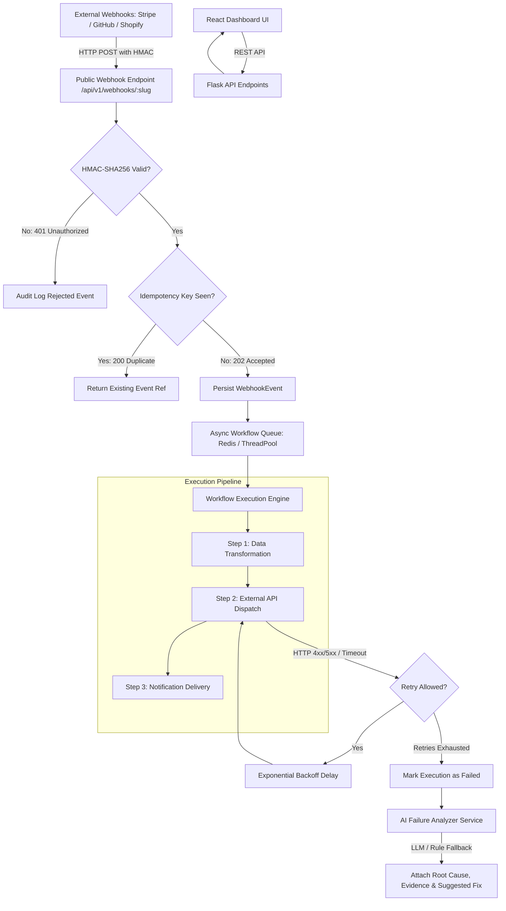
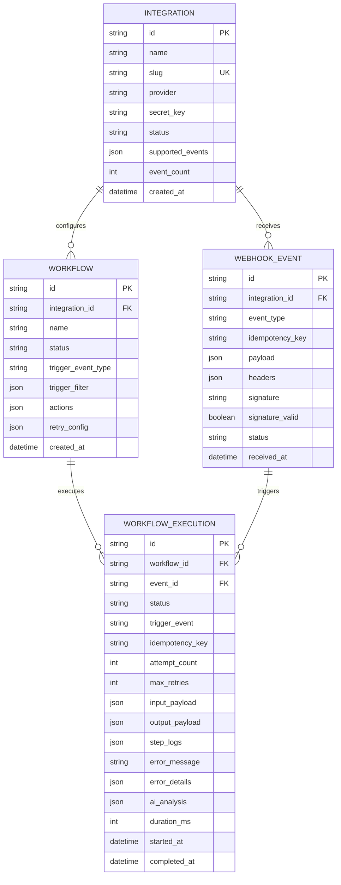

# Edvexa AI Flow: Intelligent API Integration & Workflow Automation Platform

[](tests)
[](backend)
[](frontend)
[](frontend)
[](frontend)
[](LICENSE)

An enterprise-grade, asynchronous event processing and workflow automation platform that connects external APIs, ingests signed webhooks, executes multi-step transformation and notification pipelines with exponential backoff retries, and delivers **AI-assisted root cause failure analysis**.

---

## 🌟 Key Features

### 1. Integration Management & Secure Ingestion
- **Multi-Provider Registry**: Register external platforms (Stripe, GitHub, Shopify, Slack, or Custom Webhooks).
- **HMAC-SHA256 Signature Validation**: Constant-time verification (`hmac.compare_digest`) supporting GitHub (`sha256=<hex>`), Stripe (`t=...,v1=<hex>`), and raw hex formats.
- **Idempotency & Replay Protection**: Automatic deduplication using `X-Idempotency-Key` or payload SHA-256 digest, returning cached responses (`200 OK - duplicate ignored`) to eliminate duplicate workflow execution.
- **Interactive Webhook Simulator**: Built-in 1-click test bench with realistic presets (Stripe payments, GitHub PRs, Shopify orders, and invalid signature testing).

### 2. Workflow Builder & Asynchronous Pipeline Engine
- **Non-Blocking Architecture**: Incoming webhooks are validated and acknowledged with `202 Accepted` in milliseconds, while tasks are processed asynchronously.
- **Multi-Step Action Pipeline**:
  - `transform`: JSONPath mapping, mathematical operations, and `{{template}}` string interpolation.
  - `api_call`: HTTP GET/POST/PUT/DELETE requests with dynamic header/body templating.
  - `notification`: Slack alerts, email delivery simulation, and webhook broadcasts.
- **Conditional Triggers**: Rule filters supporting `>=`, `==`, `!=`, `<`, `contains`, `exists` with dot-notation traversal (`data.amount >= 1000`).
- **Resilient Retries with Exponential Backoff**: Configurable retry policies (`delay = initial_delay * (backoff_factor ** attempt)`) with step-by-step audit logs.

### 3. AI-Assisted Failure Analysis
- **Intelligent Root Cause Diagnosis**: Analyzes failed execution logs, HTTP status codes, payloads, and step context using LLMs (Gemini / OpenAI / LangChain).
- **Graceful Deterministic Fallback**: Works 100% offline out-of-the-box without requiring external paid API keys via a deterministic heuristic expert system.
- **Actionable Log Evidence**: Highlights exact error snippets and remote responses behind each explanation.
- **Isolated Human-in-the-Loop Review**: AI diagnoses are stored separately from executions; users can review root causes, copy suggested configuration fixes, and trigger 1-click retries.

### 4. Real-Time Dashboard & Telemetry
- **Live Monitoring**: Success/failure KPIs, average latency (ms), retry counts, and live execution streams.
- **Execution Inspector**: Step-by-step collapsible timeline, payload diff viewer, and retry control.
- **Modern Glassmorphism UI**: High-contrast dark theme built with React 19, Tailwind CSS v4, and Lucide icons.

---

## 🏗️ Architecture Overview



---

## 🗄️ Database Schema

The database is built on SQLAlchemy and supports SQLite (zero-configuration local dev) and PostgreSQL (production).



---

## 🚀 Quickstart Guide

### Prerequisites
- Python 3.10+
- Node.js 18+ and npm

### 1. Clone & Set Up Backend

```bash
cd backend

# Create and activate virtual environment
python -m venv .venv

# Windows:
.\.venv\Scripts\activate
# macOS/Linux:
source .venv/bin/activate

# Install dependencies
pip install -r requirements.txt

# Run test suite
pytest -v

# Start the Flask API server
python run.py
```
*Backend will run at:* `http://127.0.0.1:5000` (pre-seeded with Stripe, GitHub, Shopify, and sample workflows).

### 2. Set Up Frontend

```bash
cd frontend

# Install dependencies
npm install

# Start development server
npm run dev
```
*Frontend will run at:* `http://localhost:5173`

---

## 🐳 Docker Deployment

Run the complete platform (Backend + Frontend + SQLite volume) with a single command:

```bash
docker compose up --build
```
- Frontend Dashboard: `http://localhost:5173`
- Backend API: `http://localhost:5000`

---

## 🧪 Automated Testing

The backend includes a comprehensive pytest suite covering all assignment criteria:

```bash
cd backend
.\.venv\Scripts\pytest -v
```

### Test Coverage Highlights:
| Test File | Description | Status |
|---|---|---|
| `tests/test_hmac.py` | HMAC SHA-256 calculation, GitHub & Stripe prefixes, constant-time validation, 401 on tampered signatures. | ✅ Passed |
| `tests/test_idempotency.py` | Duplicate event detection via `X-Idempotency-Key`, 200 duplicate skipped response. | ✅ Passed |
| `tests/test_workflows.py` | Nested data traversal, filter rule evaluator, transform actions, mock API calls, and end-to-end pipeline. | ✅ Passed |
| `tests/test_retries.py` | Exponential backoff retries when an action fails, attempt count tracking, transition to failure. | ✅ Passed |
| `tests/test_ai_analyzer.py` | Structured AI output schema validation, 401/404/429/500 diagnostic heuristics, and mock LLM fallback. | ✅ Passed |

---

## 📡 API Reference & Sample Webhook Payloads

### 1. Ingest Webhook (Public Endpoint)
`POST /api/v1/webhooks/<slug_or_id>`

#### Headers:
- `Content-Type: application/json`
- `X-Webhook-Signature: sha256=<computed_hex_signature>`
- `X-Idempotency-Key: <unique_delivery_uuid>`

#### Sample Payload (Stripe Payment):
```json
{
  "id": "evt_1P0A9x2eZvKYlo2C",
  "type": "payment.succeeded",
  "amount": 25000,
  "currency": "usd",
  "customer": {
    "id": "cus_N4v8k92",
    "name": "Sarah Connor",
    "email": "sarah@cyberdyne.org"
  }
}
```

#### Curl Command Example:
```bash
# Compute HMAC signature:
# echo -n '{"id":"evt_1","type":"payment.succeeded","amount":15000}' | openssl dgst -sha256 -hmac "whsec_stripe_demo_secret_key_998877"

curl -X POST http://127.0.0.1:5000/api/v1/webhooks/stripe-payments \
  -H "Content-Type: application/json" \
  -H "X-Webhook-Signature: sha256=COMPUTED_HEX" \
  -H "X-Idempotency-Key: idemp_order_12345" \
  -d '{"id":"evt_1","type":"payment.succeeded","amount":15000,"customer":{"name":"Alice","email":"alice@example.com"}}'
```

#### Response (202 Accepted):
```json
{
  "status": "accepted",
  "event_id": "893c7a23-41bb-4cb0-9bfa-b9a32c25e89d",
  "event_type": "payment.succeeded",
  "idempotency_key": "idemp_order_12345",
  "executions": [
    {
      "execution_id": "019d3fbc-8911-44ab-bf56-c23f71b238ef",
      "workflow_id": "d04fa871-36ba-4e9f-96a8-b64cecf19f20",
      "workflow_name": "High-Value Stripe Payment Alert & CRM Sync",
      "status": "pending"
    }
  ]
}
```

---

## 🤖 AI-Assisted Failure Analysis Model

When any workflow step fails and exhausts its configured retries:
1. The engine aggregates the error message, HTTP response, step logs, input payload, and workflow definition.
2. If `GEMINI_API_KEY` or `OPENAI_API_KEY` is present, it prompts the model for structured JSON output.
3. If no key is set or the external service fails, the deterministic heuristic engine analyzes the status codes and logs.
4. The structured output is saved to the execution record:

```json
{
  "summary": "Authentication Failure in Call External Billing Recovery API",
  "root_cause": "The target endpoint (https://api.external-billing.com/v2/disputes) rejected the request with HTTP 401. The Authorization header or API token is missing, expired, or possesses insufficient permissions.",
  "evidence": "Failed step: 'Call External Billing Recovery API'. Error: HTTP 401: Invalid or expired Bearer token provided in Authorization header.",
  "suggested_action": "Verify the 'Authorization' header in this action's configuration. Ensure your Bearer token or API key is valid and has not expired.",
  "suggested_config_diff": {
    "headers": {
      "Authorization": "Bearer <YOUR_ACTIVE_TOKEN>"
    }
  },
  "confidence_score": 0.95,
  "provider": "rule_based_fallback"
}
```

---

## 💡 CodeZero Development Workflow

This platform was developed adhering to the **CodeZero development workflow recommended by Edvexa**:
1. **Architectural Planning**: Mapped out asynchronous processing decoupled from synchronous webhook ingestion, deterministic HMAC verification, and fallback AI architectures.
2. **Feature Implementation**: Built modular layers for models, HMAC validation, workflow execution engine, heuristic and LLM diagnostics, and interactive React views.
3. **Validation & Debugging**: Validated edge cases (detached SQLAlchemy sessions, duplicate idempotency keys, and Windows console Unicode handling) using automated pytest suites and browser automation subagents.

---

## 🔮 Production Roadmap & Scaling Considerations

For enterprise scale deployments:
1. **Distributed Queues**: Replace in-process ThreadPool with Redis + RQ / Celery or AWS SQS / RabbitMQ with Dead Letter Queues (DLQ).
2. **Distributed Locks**: Implement Redlock / Redis-based distributed mutexes for idempotency key validation under high concurrency.
3. **PostgreSQL Clustering & Partitioning**: Partition `webhook_events` and `workflow_executions` by date range to maintain low index overhead.
4. **DAG Workflow Builder**: Upgrade step pipeline to a full directed acyclic graph (DAG) supporting conditional branching and parallel step execution.
